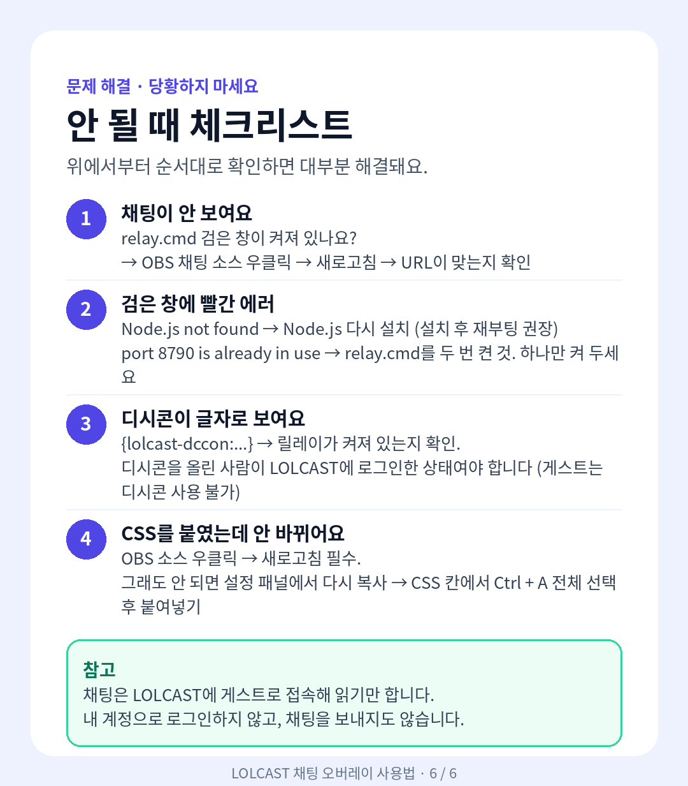

# LOLCAST 채팅 오버레이 (OBS용) — 초보자 그림 사용법

LOLCAST 채팅을 OBS 방송 화면에 띄우고, 디시콘·GIF도 그대로 나오게 하는 방법입니다.
아래 그림을 순서대로 따라 하면 됩니다.

## 전체 흐름


1. Node.js 설치 (처음 한 번만)
2. `relay.cmd` 실행
3. OBS에 브라우저 소스로 채팅 화면 추가
4. (선택) 크기·색 조정

## 1. Node.js 설치 (처음 한 번만)


- https://nodejs.org/ko 접속 → **LTS** 초록색 버튼으로 다운로드
- 받은 파일 실행 → 계속 **다음** (설정 변경 불필요)
- 확인: `Win + R` → `cmd` → `node -v` → `v18` 이상이면 OK
- 이미 설치되어 있다면 이 단계는 건너뜁니다.

## 2. relay.cmd 실행


- 압축 푼 `lolcast-obs` 폴더에서 `relay.cmd` 더블클릭
- 검은 창에 아래 두 줄이 나오면 정상입니다.

```
[relay] http://127.0.0.1:8790
[chat]  connected as guest
```

> **방송하는 동안 검은 창은 절대 닫지 마세요.** 닫으면 채팅이 멈춥니다. 최소화는 괜찮고, 방송이 끝나면 닫아도 됩니다.

## 3. OBS에 채팅 화면 넣기


1. OBS 아래쪽 소스 목록에서 `+` → **브라우저** 선택 (이름 예: `lolcast 채팅`)
2. URL 칸에 아래 주소 입력 (경로만 본인 폴더에 맞게 변경)

```
file:///C:/내가푼폴더/lolcast-obs/obs-src/chat-overlay.html
```

- 쉬운 방법: `chat-overlay.html` 파일을 OBS 창으로 끌어다 놓으면 주소가 자동으로 들어갑니다.
3. 폭 `700` × 높이 `600` 입력 (예시, 원하는 크기로 조절 가능)
4. 아래 2개는 **반드시 끄기**
   - "장면이 활성화되면 새로고침" → 끔
   - "화면에 보이지 않을 때 종료" → 끔
5. 확인 → 방송 화면에서 원하는 위치로 드래그

## 4. 크기·색 바꾸기 (선택 사항)


1. `obs-src` 폴더 안의 `chat-overlay.html` 더블클릭 → 브라우저에 설정 패널이 나옵니다.
2. 슬라이더를 움직이면 위쪽 미리보기가 즉시 바뀝니다. (콘 크기 24~240, 글자 크기, 채팅 모양 기본형/컬러형, 닉네임 색, 글자 테두리)
3. **`OBS용 코드 복사`** 버튼 클릭
4. OBS에서 채팅 소스 우클릭 → 속성 → **사용자 지정 CSS** 칸에 `Ctrl + V` 붙여넣기 → 확인
5. OBS 화면에서 채팅 소스 우클릭 → **새로고침** (이걸 눌러야 적용됩니다)

> 설정 패널은 OBS로 열면 자동으로 숨겨져 방송에 나가지 않습니다.
> 컬러형은 사람마다 닉네임 색이 다르게 나오는 모양입니다.

## 안 될 때 체크리스트



- **채팅이 안 보여요**: `relay.cmd` 검은 창이 켜져 있는지 확인 → OBS 채팅 소스 우클릭 → 새로고침 → URL 확인
- **검은 창에 빨간 에러**
  - `Node.js not found` → Node.js 다시 설치 (설치 후 컴퓨터 재부팅 권장)
  - `port 8790 is already in use` → `relay.cmd`를 두 번 켠 것. 하나만 켜 두세요.
- **디시콘이 글자로 보여요** (`{lolcast-dccon:...}`): 릴레이가 켜져 있는지 확인. 디시콘을 올린 사람이 LOLCAST에 로그인한 상태여야 합니다 (게스트는 디시콘 사용 불가).
- **CSS를 붙였는데 안 바뀌어요**: OBS 소스 우클릭 → 새로고침 필수. 그래도 안 되면 설정 패널에서 다시 복사 → CSS 칸에서 `Ctrl + A` 전체 선택 후 붙여넣기.

## 참고

- 채팅은 LOLCAST에 **게스트로 접속해 읽기만** 합니다. 내 계정으로 로그인하지 않고, 채팅을 보내지도 않습니다.
- 원본 텍스트 사용법은 `lolcast-obs` 압축 파일 안의 `사용법.txt`를 참고하세요.
